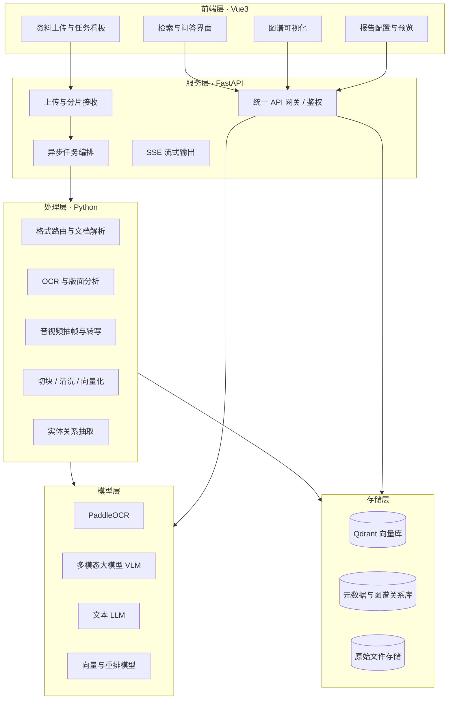
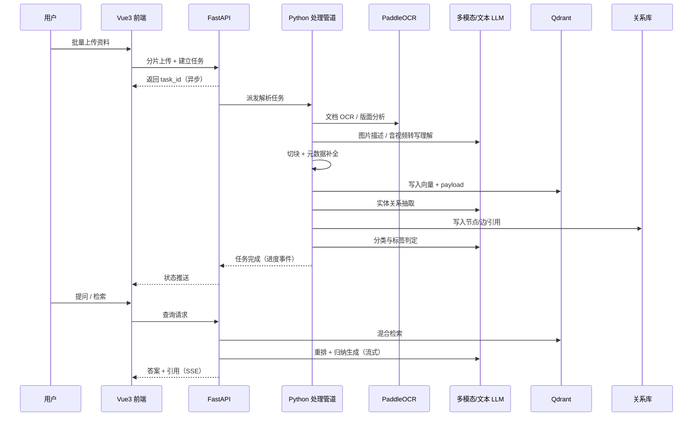

# 《基于多模态大模型与知识图谱的智能知识管理系统》产品方案

| 项目名称 | 《基于多模态大模型与知识图谱的智能知识管理系统》 |
| --- | --- |
| 产品形态 | 面向个人用户的本地化 / 私有化部署知识管理应用（Web 端） |
| 目标用户 | 学生、科研人员、职场知识工作者、自由职业者 |
| 技术底座 | Python + FastAPI + Vue3 + PaddleOCR + Qdrant + LLM（多模态大模型） |
| 核心能力 | 多格式解析入库 → 自动结构化 → 语义检索 → 跨文档问答 → 知识图谱 → 报告生成 |
| 价值主线 | 把"存得进去但找不出来、看不完也理不清"的个人资料，变成"可搜索、可问答、可分析"的个人知识库 |

---

## 一、项目概述

### 1.1 项目定位

《基于多模态大模型与知识图谱的智能知识管理系统》是一款**面向个人用户**的智能知识管理工具。它的核心目标只有一句话：

> 将 PDF、图片、录音、视频等多格式异构资料，统一转换为**可搜索、可问答、可深度分析**的结构化个人知识库。

围绕这一目标，系统承担三类职责：

1. **统一入口**：无论资料是 PDF 论文、手机拍的纸质笔记、会议录音还是课程录屏，都通过同一套上传与管理入口进入系统，不再散落在网盘、微信收藏、下载文件夹和相册里。
2. **统一表示**：所有资料被解析为同一种"可计算"的中间形态——带来源定位信息的文本块 + 向量 + 实体与关系，使不同模态的资料可以在同一个语义空间里被检索和关联。
3. **统一消费**：检索、问答、图谱、报告四种消费方式共享同一份知识底座，用户不需要为"找资料""问问题""看关系""写总结"分别切换工具。

### 1.2 目标用户画像

| 用户类型 | 典型资料构成 | 核心诉求 |
| --- | --- | --- |
| 学生 / 备考者 | 教材 PDF、课件 PPT、手写笔记照片、网课录屏 | 快速定位知识点、跨资料串联复习、生成复习材料 |
| 科研 / 研究生 | 论文 PDF、实验数据表、会议录音、图表截图 | 文献综述、方法对比、实验记录追溯 |
| 职场知识工作者 | 行业报告、会议录音、培训视频、方案截图 | 会议结论回溯、方案复用、快速形成汇报材料 |
| 自由职业者 / 创作者 | 灵感截图、采访录音、素材视频、参考图 | 素材可检索、灵感可关联、选题可成稿 |

四类用户的共同特征是：**资料数量在千级、格式在五种以上、且高度个人化**——这正是通用网盘与企业知识库都无法覆盖的中间地带。

### 1.3 服务边界

明确"做什么"与"不做什么"，是保证产品可交付、可验收的前提。

**系统做：**

- 个人资料的导入、解析、结构化、存储、检索、问答、可视化与报告输出；
- 单机 / 单用户部署（Docker Compose 一键启动），数据默认不出本机；
- 对解析结果与模型输出给出**来源定位**（页码、时间戳、区域坐标）与**置信度**；
- 用户对分类、标签、图谱关系的**人工修正与反馈回流**。

**系统不做：**

- 不做多人协作、组织架构与细粒度企业权限体系（个人产品定位，避免功能泛化）；
- 不做公网爬虫与内容抓取，资料仅来源于用户主动上传或本地目录挂载；
- 不做实时音视频流处理，仅处理已完成的音视频文件；
- 不输出法律、医疗、投资等专业领域的结论性意见，问答结果统一标注为"基于个人资料的辅助参考"；
- 不做通用办公套件，不与在线文档编辑能力竞争。

### 1.4 核心价值主张

| 价值维度 | 传统做法 | 本系统 |
| --- | --- | --- |
| 存储 | 网盘按文件夹堆叠，命名随意 | 按语义自动归类，标签与目录双轨 |
| 检索 | 文件名 + 全文关键词，图片/音视频不可检索 | 语义检索，跨模态统一召回 |
| 理解 | 逐份打开、逐页阅读 | 跨文档问答，答案带原文出处 |
| 关联 | 靠记忆串联资料 | 知识图谱自动呈现实体与关系 |
| 输出 | 手工整理笔记与汇报 | 一键生成带引用的知识报告 |

---

## 二、产品实用性（评分维度：产品实用性，13 分）

本章按"**场景 → 痛点 → 功能 → 价值 → 可验证场景**"逐条对应展开，确保每一项痛点都有明确的功能承接，每一项功能都有可落地的使用场景。

### 2.1 场景一：资料管理——"存得进去，但管不起来"

#### 2.1.1 具体痛点

| 编号 | 痛点描述 | 现状表现 | 影响 |
| --- | --- | --- | --- |
| P1-1 | 多源分散 | 资料分布在下载目录、网盘、聊天软件收藏、手机相册、录音 App，至少 4 个入口 | 找不到"我到底有没有存过这份资料" |
| P1-2 | 命名随意 | "最终版.pdf""新建文件夹(3)""微信图片_20250312.jpg" | 无法通过文件名判断内容 |
| P1-3 | 格式不可读 | 扫描版 PDF 无文本层，图片、录音、视频完全无法全文检索 | 约 40%–60% 的个人资料实质处于"死档"状态 |
| P1-4 | 整理成本高 | 手工建目录、改名、打标签，每 100 份资料约需数小时 | 用户放弃整理，形成"存而不管"的恶性循环 |
| P1-5 | 重复囤积 | 同一份资料以不同文件名存多份，版本无法区分 | 存储冗余，引用时不知哪份最新 |

#### 2.1.2 对应功能与价值

- **OCR 文档识别**：让扫描件、截图型 PDF、图片笔记获得文本层，从"只能看"变为"能被搜"。
  → 直接解决 P1-3，使可检索资料占比从约 50% 提升至 95% 以上。
- **图片与视频内容理解**：把录音、录屏、图片中的语音与画面转成带时间戳的文本与结构化描述。
  → 解决 P1-3 中音视频"死档"部分。
- **自动分类与标签生成**：入库即完成一级/二级分类与主题、实体、来源标签，用户无需手工建目录。
  → 解决 P1-2、P1-4，把"整理 100 份资料数小时"压缩为"确认少量待定标签数分钟"。
- **知识关系图谱**：同名/同主题资料在图上自然聚拢，重复与版本关系可见。
  → 缓解 P1-5。
- **统一导入入口**：Web 端批量上传 + 本地目录挂载 + 浏览器拖拽，单一入口收敛多源资料。
  → 解决 P1-1（入口层面），用户只需"往一个地方放"。

#### 2.1.3 可落地典型场景

> **场景 A：研究生小陈的毕业论文资料整理**
> 小陈手上有 180 篇 PDF 论文、60 张实验截图、12 段组会录音、3 个课程录屏。过去他靠"作者_年份_关键词"手工命名，仍有约三分之一找不到。
> 使用系统后：一次性拖入全部资料，系统在后台完成解析；1 小时后他得到按"研究方向 → 方法/数据集/结论"自动分层分类的资料库，每篇论文自动带出方法名、数据集、指标等实体标签；同一篇论文的预印本与正式版在关系图上以"版本"边相连，重复文件被标记。
> **结果**：整理动作从"数小时手工"变为"数分钟确认"，且分类结果可持续复用。

### 2.2 场景二：知识沉淀——"看得完，但理不清"

#### 2.2.1 具体痛点

| 编号 | 痛点描述 | 现状表现 | 影响 |
| --- | --- | --- | --- |
| P2-1 | 只读不记 | 资料读完即忘，笔记散落在多个工具 | 知识无法复用，重复阅读 |
| P2-2 | 笔记与原文脱节 | 笔记里的一句话，回头找不到出自哪份资料第几页 | 引用不可信，写作时反复核对 |
| P2-3 | 跨资料关联缺失 | A 论文的方法与 B 报告的结论相关，但用户不知道 | 错失交叉洞察 |
| P2-4 | 输出成本高 | 综述、周报、汇报材料需手工摘录、拼接、排版 | 单次输出耗时半天以上 |
| P2-5 | 沉淀无结构 | 笔记是线性流水账，没有主题、实体、时间维度 | 沉淀越多越难用 |

#### 2.2.2 对应功能与价值

- **自动生成知识报告**：按主题、时间线、对比、增量四种维度生成带引用的结构化报告，并支持导出。
  → 解决 P2-4、P2-5，把"半天手工摘录"变为"分钟级生成 + 人工润色"。
- **跨文档智能问答**：以问答方式完成"读—问—记"，答案附带原文出处，可直接沉淀为带引用的笔记。
  → 解决 P2-1、P2-2。
- **知识关系图谱**：自动抽取实体与关系，把"资料之间"的隐含关联显式化，支持社区发现与路径查询。
  → 解决 P2-3、P2-5。
- **标签体系 + 时间/来源维度**：让沉淀天然具备多维切面，而非单一文件夹树。
  → 解决 P2-5。

#### 2.2.3 可落地典型场景

> **场景 B：职场用户李女士的季度行业研究**
> 李女士每季度需要输出一份行业观察。她的资料是 40 份券商报告 PDF、8 段专家访谈录音、若干发布会视频切片。
> 使用系统后：她在问答框依次提出"近三个月各机构对行业增速的预测区间是多少""哪些机构下调了预期、理由是什么""专家访谈里提到的渠道库存问题出现在哪些录音的第几分钟"；系统跨 48 份资料给出带引用的对比答案，并一键生成《Q3 行业观察》报告初稿，报告每个结论后均标注来源文档与页码/时间戳。
> **结果**：初稿形成时间从 2 天缩短到 2 小时，且引用可逐条回溯核验。

### 2.3 场景三：信息检索——"搜得到字，但搜不到意思"

#### 2.3.1 具体痛点

| 编号 | 痛点描述 | 现状表现 | 影响 |
| --- | --- | --- | --- |
| P3-1 | 只能字面匹配 | 搜"召回率"找不到写"Recall"的资料；搜"报销流程"找不到标题为"费用制度"的文件 | 命中率低，用户误以为"没存过" |
| P3-2 | 跨模态不可搜 | 图片、音频、视频内容完全无法被检索 | 大量资料实质不可用 |
| P3-3 | 结果无定位 | 命中一个 PDF，还要自己翻页找位置 | 单次检索的后续成本高 |
| P3-4 | 无法带条件检索 | 不能"在近半年的会议录音里找关于预算的讨论" | 结果噪声大 |
| P3-5 | 搜到片段但回答不了问题 | 检索给的是链接列表，用户仍需自己阅读归纳 | 检索只是"找文件"，不是"得答案" |

#### 2.3.2 对应功能与价值

- **RAG 语义搜索**：向量检索 + 关键词检索混合召回，语义相近即可命中，不受措辞差异影响；支持按标签、时间、文件类型、来源过滤。
  → 解决 P3-1、P3-4。
- **跨模态统一向量空间**：图片描述、视频转写片段与文档文本块进入同一向量空间，支持"用文字搜图片/视频片段"。
  → 解决 P3-2。
- **块级定位与跳转**：每条结果精确到文档页码、图片区域、视频时间戳，一键跳转原文位置。
  → 解决 P3-3。
- **跨文档智能问答**：在检索结果之上直接给出归纳答案，并保留可展开的引用列表。
  → 解决 P3-5。

#### 2.3.3 可落地典型场景

> **场景 C：备考学生小张的知识点检索**
> 小张备考期间积累了大量课件 PPT、教材扫描页、手写笔记照片与网课录屏。过去他搜"梯度消失"只能搜到 PPT 文件名。
> 使用系统后：他输入"梯度消失是怎么产生的、有什么缓解办法"，系统同时召回 3 份课件中的相关段落、1 张手写笔记照片上的公式区域、以及网课视频第 12 分 30 秒的讲解片段；答案按"成因—缓解方法—各资料观点差异"组织，每条结论后附来源，点击可直接跳到对应页码与视频时间点。
> **结果**：一次提问完成原本需要翻 4 类资料、约 30 分钟的检索与阅读。

### 2.4 痛点—功能—价值对照矩阵

| 痛点编号 | 承接功能 | 用户可感知价值 | 可验证方式 |
| --- | --- | --- | --- |
| P1-1 | 统一导入入口 | 一个入口收纳所有资料 | 导入成功率、来源覆盖类型数 |
| P1-2 / P1-4 | 自动分类与标签生成 | 入库即有序，无需手工整理 | 自动分类准确率、人工修正比例 |
| P1-3 | OCR 文档识别、图片与视频内容理解 | 扫描件与音视频变为可检索 | 可检索资料占比 |
| P1-5 | 知识关系图谱、重复检测 | 重复与版本关系可见 | 重复识别召回率 |
| P2-1 / P2-2 | 跨文档智能问答 | 问答即笔记，结论可溯源 | 引用覆盖率、跳转准确率 |
| P2-3 / P2-5 | 知识关系图谱、标签体系 | 关联显式化，沉淀有结构 | 图谱实体/关系覆盖量 |
| P2-4 | 自动生成知识报告 | 报告分钟级成稿 | 单份报告生成耗时、导出成功率 |
| P3-1 | RAG 语义搜索 | 换个说法也能搜到 | Recall@20、Top-5 命中率 |
| P3-2 | 跨模态统一向量空间 | 图片、视频内容可被文字检索 | 跨模态检索命中率 |
| P3-3 | 块级定位与跳转 | 一键回到原文位置 | 定位准确率 |
| P3-4 | 检索过滤条件 | 带条件精准检索 | 过滤后结果相关性 |
| P3-5 | 跨文档智能问答 | 从"找文件"升级为"得答案" | 答案有用率、拒答准确率 |

### 2.5 实用性验证方式

1. **可用性测试**：招募 12–15 名目标用户（学生/科研/职场各 4–5 名），每人导入不少于 50 份自有资料，完成"找一份资料、回答一个问题、生成一份报告"三项任务，记录任务完成率与耗时。
2. **前后对比**：同一批资料在"本地文件夹 + 系统搜索"与"本系统检索/问答"两种方式下的任务耗时对比。
3. **质量抽检**：对解析、分类、检索、问答结果各抽检 100 条，按第 3 章定义的验收口径打分。
4. **持续反馈**：用户对分类、标签、答案的修正行为被记录为反馈数据，用于规则与提示词迭代。

**通过标准**：三项核心任务完成率 ≥ 90%；检索类任务平均耗时较传统方式下降 ≥ 60%；问答结果引用覆盖率 ≥ 95%；用户主观可用性评分（5 分制）≥ 4.0。

---

## 三、核心功能设计

每个功能按"**功能说明 → 输入输出 → 规则与指标 → 用户价值 → 验收口径**"展开。

### 3.1 OCR 文档识别

#### 功能说明

将用户上传的文档类资料统一解析为带版面结构的文本，作为后续一切能力的数据底座。系统区分三条解析路径，并自动路由：

| 解析路径 | 适用输入 | 处理方式 |
| --- | --- | --- |
| 文本层直取 | 原生 PDF、DOCX、PPTX、XLSX、TXT、Markdown | 直接抽取文本与结构，保留标题层级与表格 |
| 版面解析 | 扫描版 PDF、图片（JPG/PNG/BMP/TIFF/WEBP）、含图 PDF 的图片页 | PaddleOCR 版面分析 + 文本识别 + 表格结构识别 |
| 混合回退 | 文本层残缺（乱码、缺字、双栏错序） | 文本层质量评分低于阈值时自动回退到版面解析，取两者较优结果 |

**支持格式范围**：PDF（含加密文档的授权解密）、DOCX/DOC、PPTX/PPT、XLSX/XLS、TXT/MD、JPG/PNG/BMP/TIFF/WEBP，单文件默认上限 200 MB / 1000 页。

#### 识别精度量化要求

| 指标 | 定义 | 目标值 |
| --- | --- | --- |
| 中文印刷体字符准确率 CAR | 1 − 字符编辑距离 / 字符总数，测试集为 500 页真实个人资料 | ≥ 98% |
| 英文印刷体字符准确率 | 同上，英文测试集 200 页 | ≥ 99% |
| 表格结构还原准确率 | 单元格边界与行列归属正确的比例 | ≥ 90% |
| 版面区域检测 mAP@0.5 | 标题/正文/表格/图片/页眉页脚五类区域 | ≥ 0.90 |
| 阅读顺序正确率 | 多栏、图文混排页面的块顺序与人工标注一致的比例 | ≥ 92% |
| 手写体识别准确率 | 清晰手写笔记测试集 100 页 | ≥ 85%，且逐块输出置信度 |
| 低质量件降级策略 | 倾斜 > 5°、分辨率 < 150 dpi、低对比度 | 自动预处理（去噪/纠偏/增强）后再识别，仍不达标则标记"低置信"由用户确认 |

#### 结构化输出标准规范

所有解析结果统一落到 **Document Schema（JSON）**，字段规范如下：

```json
{
  "doc_id": "uuid",
  "file": { "name": "xxx.pdf", "type": "pdf", "size": 1234567, "pages": 42, "sha256": "..." },
  "source": { "channel": "upload", "imported_at": "2026-11-16T10:00:00+08:00" },
  "pages": [
    {
      "page_no": 12,
      "width": 1654, "height": 2339,
      "blocks": [
        {
          "block_id": "p12_b03",
          "type": "paragraph | title | table | figure | list | header | footer",
          "order": 3,
          "bbox": [120, 340, 1490, 520],
          "text": "识别后的正文内容",
          "confidence": 0.972,
          "table": { "rows": 4, "cols": 3, "cells": [["表头1", "表头2", "表头3"]] },
          "figure": { "caption": "图 3 系统架构", "ocr_text": "图内文字" }
        }
      ]
    }
  ],
  "quality": { "text_layer": "none | partial | full", "parse_route": "ocr", "overall_confidence": 0.95 },
  "chunks": [ { "chunk_id": "c_001", "text": "...", "page_from": 12, "page_to": 12, "block_ids": ["p12_b03"], "token_count": 412 } ]
}
```

规范约束：

1. **必填字段**：`doc_id`、`file`、`pages[].blocks[].text/type/bbox/order`、`chunks`；缺失即解析失败，进入重试队列。
2. **阅读顺序**：`order` 必须在页面内单调递增，跨页按页号递增，保证上下文拼接不串行。
3. **块级溯源**：每个 `chunk` 必须能映射回 `block_id` 与页码，这是问答引用可跳转的前提。
4. **表格不丢结构**：表格以二维单元格数组输出，禁止拍平为一行文本。
5. **置信度必带**：块级 `confidence` 低于 0.75 的块在检索结果中标注"识别存疑"，并允许用户手工修正。

#### 用户价值

- 让占个人资料近半数的扫描件、截图型文档从"不可检索"变为"可检索"；
- 结构化输出保证后续检索、问答、图谱、报告共享同一份可靠底座，避免"每换一个功能就重解析一遍"；
- 低置信块显式暴露风险，用户知道哪里需要人工核对，而不是盲信结果。

#### 验收口径

500 页真实个人资料测试集上 CAR ≥ 98%，表格结构还原 ≥ 90%，块级溯源准确率 100%，单份 200 页 PDF 解析耗时 ≤ 3 分钟。

### 3.2 图片与视频内容理解

#### 功能说明

对非文档类资料做"视觉 + 语音"双通道解析，把不可检索的画面与声音转换为带时间/空间定位的结构化文本。

**视觉通道解析范围：**

| 内容类型 | 解析能力 | 提取维度 |
| --- | --- | --- |
| 自然场景照片 | 场景与主体识别、拍摄场景描述 | 场景类别、主要对象、动作、环境线索 |
| 图表 / 数据截图 | 图表类型识别、坐标轴与图例读取、数据点趋势描述、图内文字 OCR | 图表类型、指标名、数值与趋势、结论句 |
| 演示文稿 / 文档截图 | 版面还原、标题与要点抽取 | 标题、要点列表、图内文字 |
| 手写 / 白板 / 板书 | 文字识别 + 公式与箭头关系粗解析 | 文字内容、公式、层级结构 |
| 票据 / 表单 / 名片 | 关键字段抽取 | 单据类型、日期、金额、机构、联系人 |
| 屏幕截图 | 应用与页面类型识别、界面文字抽取 | 页面类型、关键操作路径、可见文案 |

**语音通道解析范围：**

| 内容类型 | 解析能力 | 提取维度 |
| --- | --- | --- |
| 录音（会议、访谈、课堂） | 语音转写、说话人分离（可选）、语句时间戳 | 逐句文本 + start/end 时间戳 + 说话人编号 |
| 视频音轨 | 同录音，并与画面时间轴对齐 | 时间轴文本、章节断点 |
| 视频画面 | 关键帧抽取 + 画面描述 + 帧内文字 OCR | 关键帧描述、场景切换点、画面中出现的文字与物体 |

**统一信息提取维度**（图片与视频均输出同一套结构）：

- **描述维度**：内容概述、场景、主体、动作；
- **文本维度**：画面内文字、语音转写文本；
- **实体维度**：人物、机构、地点、产品、数值、时间；
- **结构维度**：图表类型与数据趋势、页面版式、时间轴章节；
- **溯源维度**：图片区域坐标（bbox）、视频时间戳（start/end）、关键帧编号。

**视频处理规则**：场景切换检测 + 每 2 秒固定抽帧的上限控制（避免长视频爆量）；音频按 30 秒滑窗转写并与帧时间轴对齐；单视频默认上限 2 小时，超限提示分段处理。

#### 用户价值

- 会议录音、课程录屏、采访视频不再需要"重听一遍"，可直接被关键词与语义检索命中，并跳转到具体时间点；
- 图表截图能读出趋势与数值，避免"只存图看不懂"；
- 图片中的实体进入图谱，使"这张照片里的人和项目"与文本资料产生关联。

#### 验收口径

图片内容描述的相关性人工评分（5 分制）≥ 4.0；图内文字 OCR 准确率 ≥ 95%；语音转写字错率（CER）在清晰录音上 ≤ 8%；时间戳与音频实际位置偏差 ≤ 1 秒；视频关键帧召回（含关键信息画面）≥ 90%。

### 3.3 自动分类与标签生成

#### 功能说明

在不要求用户手工建目录的前提下，为每份资料自动生成"**分类路径 + 标签集合 + 置信度**"，并保证用户可编辑、可覆盖、可固化。

**分类逻辑规则（四级判定，优先级从高到低）：**

1. **用户显式规则优先**：用户自定义规则（如"文件名含'发票' → 财务/票据"）命中即确定，模型不得覆盖。
2. **来源与结构规则**：依据文件类型、目录来源、命名模式、页数、是否含表格等结构特征做初判（如"PPTX + 页数 < 30 → 课件/演示"）。
3. **语义归类**：文档向量与各分类的类心向量做相似度比较，同时对文档摘要做 LLM 归类判断，二者加权投票。
4. **兜底策略**：全部置信度低于阈值时归入"待整理"，并进入用户的待确认队列，而不是强行分配错误分类。

**分类体系**：两级结构（一级领域 8–12 个：学习、科研、工作、财务、健康、生活、创作、法律事务等；二级子类由系统初始内置、运行中依用户资料分布自动提议新增）。分类是"目录"，数量受控，不随资料膨胀。

**标签体系自动生成规则**：

| 标签类型 | 生成方式 | 示例 |
| --- | --- | --- |
| 实体标签 | 图谱实体抽取结果回写 | 「Transformer」「李某某」「XX 银行」 |
| 主题标签 | 文档关键词 + 主题聚类，取聚类中心词 | 「模型压缩」「渠道库存」 |
| 类型标签 | 结构规则判定 | 「论文」「会议纪要」「课件」「票据」 |
| 来源标签 | 导入渠道与元数据 | 「微信导入」「扫描件」「录屏」 |
| 时间 / 地目标签 | 元数据与实体抽取 | 「2026-Q3」「上海」 |

**置信度与人工干预规则：**

- 置信度 ≥ 0.75：自动写入，正常展示；
- 0.45 ≤ 置信度 < 0.75：自动写入但标记"待确认"，进入批量确认队列；
- 置信度 < 0.45：仅作为候选展示，不写入；
- 单份资料自动标签上限 12 个，按置信度排序，避免标签噪声；
- 用户可执行：新增、删除、重命名、合并同义标签、锁定标签（锁定后模型不再改写）、调整分类路径；
- 用户修正行为写入反馈集，用于更新分类规则与提示词示例，形成"越用越准"的闭环。

#### 用户价值

- 入库即有序，省去手工建目录、改名、打标签的时间；
- 待确认队列把"全量人工"压缩为"少量确认"，兼顾准确率与效率；
- 标签可编辑、可锁定，用户保留最终控制权，避免被模型"强行归类"。

#### 验收口径

一级分类准确率 ≥ 90%、二级分类准确率 ≥ 80%（人工标注测试集）；自动标签精确率 ≥ 85%；用户修正率 ≤ 15%；标签体系规模在 300 份资料后收敛（新增标签增速显著下降）。

### 3.4 RAG 语义搜索

#### 功能说明

以"混合召回 + 重排 + 上下文组装"构成的检索链路，支持文本、图片描述、视频转写片段在同一入口检索。

**实现链路：**

1. **切块**：语义切块与结构切块并行——按 Document Schema 的段落/表格边界切分，目标块长 300–800 tokens，重叠 15%；表格与图片描述独立成块并保留标题上下文。
2. **双路召回**：
   - 稠密检索：文本块向量存入 Qdrant，按余弦相似度召回；
   - 稀疏检索：关键词/BM25 风格倒排召回，保证专有名词、编号、代码符号等精确匹配不丢失；
   - 两路结果用 RRF（Reciprocal Rank Fusion）融合。
3. **重排**：对融合后的 Top-50 做交叉编码器重排，取 Top-K 进入上下文。
4. **过滤**：在 Qdrant payload 上做前置过滤，支持按文档类型、标签、分类、时间范围、来源、单文档内检索。
5. **组装**：按"同文档连贯、跨文档去重"原则拼接上下文，每段保留页码/时间戳元数据。
6. **查询改写**：对短查询、口语化查询做改写与同义扩展（如"召回率" ↔ "Recall"），提升同义命中。

**检索精度指标：**

| 指标 | 定义 | 目标值 |
| --- | --- | --- |
| Recall@20 | 前 20 条召回中包含相关块的比例 | ≥ 95% |
| Top-5 命中率 | 前 5 条中至少 1 条相关块的查询占比 | ≥ 90% |
| MRR | 首个相关结果排名倒数的均值 | ≥ 0.80 |
| 精确率@5 | 前 5 条中相关块占比 | ≥ 70% |
| P95 检索延迟 | 10 万块规模下端到端检索耗时 | ≤ 800 ms |
| 跨模态命中率 | 以文字查询命中图片/视频片段的比例 | ≥ 85% |

**召回覆盖范围：** 全库、指定文件夹/分类、指定标签集合、时间区间、单文档内、指定模态（仅图片/仅音视频/仅文档）。

#### 用户价值

- 措辞不同也能命中，减少"以为没存过"的重复收集；
- 专有名词与编号不丢失，兼顾"懂意思"和"找得准"；
- 带条件检索把噪声降到可接受范围；
- 结果精确到块与页码，检索之后不需要二次翻找。

#### 验收口径

在自建 200 条查询的评测集上达到上表指标；同一查询连续 5 次结果的排序稳定性一致（同参数下确定性可复现）。

### 3.5 跨文档智能问答

#### 功能说明

在检索结果之上，由大模型完成"多文档聚合 → 归纳 → 带引用作答"，并明确能力边界。

**上下文关联能力边界：**

| 边界项 | 规则 |
| --- | --- |
| 单次参与文档数 | 默认 1–10 份，超出按相关度排序截断并在答案中说明"已选取最相关 N 份" |
| 单次上下文预算 | 按模型窗口动态分配，检索上下文占 70%，对话历史占 20%，系统指令占 10% |
| 长文档处理 | 超过单次预算的文档先做分层摘要（段级 → 章级），以"摘要 + 高相关原文块"双通道注入 |
| 多轮对话 | 支持最多 10 轮上下文；对含指代的追问（"它的局限呢"）先做指代消解与查询改写 |
| 跨模态问答 | 可同时引用文档段落、图片描述、视频转写片段，答案中按来源类型分别标注 |
| 越界问题 | 与个人资料无关或资料中无依据时，明确拒答并提示"资料中未找到相关依据"，不编造 |

**答案溯源实现机制：**

1. **块级强制引用**：模型输出采用结构化格式，每个结论句绑定一个或多个 `chunk_id`；生成后做**引用校验**——校验引用的 `chunk_id` 是否真实存在于本次上下文，不存在的引用直接剔除该句或重新生成。
2. **定位还原**：`chunk_id → block_id → page_no / bbox / 时间戳`，前端展示"文档名 · 第 12 页"或"录音名 · 12:30"，点击跳转原文对应位置并高亮。
3. **引用可视化**：答案每段末尾展示可展开的引用卡片（原文片段 + 来源 + 置信度），支持"仅看有引用内容"。
4. **无引用标注**：模型自行推断、资料未直接支撑的内容，统一标记为「模型推断」并使用弱化样式，与有据内容区分。
5. **可信度提示**：当引用块平均置信度 < 0.75（多为 OCR 低置信）时，答案顶部提示"部分依据来自低置信识别结果，建议核对原文"。

#### 用户价值

- 一次提问覆盖多份资料，替代"逐份阅读 + 手工归纳"；
- 每条结论都能点回原文，结论可被自己复核，避免"AI 说得像真的"；
- 明确拒答优于编造，降低误用风险；
- 多轮追问保持上下文，接近"和资料对话"的体验。

#### 验收口径

引用覆盖率（有实质性结论的句子带有效引用的比例）≥ 95%；引用跳转定位准确率 ≥ 98%；无依据问题的正确拒答率 ≥ 90%；答案有用率（人工评分 ≥ 4 分）≥ 85%；首字响应 ≤ 3 秒（流式输出）。

### 3.6 知识关系图谱

#### 功能说明

从解析结果中自动抽取实体与关系，构建个人知识图谱，并提供可交互的可视化。

**自动构建逻辑（五步流水线）：**

1. **实体抽取**：LLM 按预定义实体类型（人物、机构、概念/方法、产品、地点、事件、文献、数据集、指标）抽取；同时用规则词典补充编号、缩写、专有名词。
2. **实体消歧与合并**：三级判定——别名/缩写词典精确匹配 → 实体名向量相似度（≥ 0.9 视为同义）→ LLM 结合上下文判断共指；合并结果保留全部别名，可人工拆分。
3. **关系抽取**：预定义关系类型（属于、提出、使用、基于、对比、引用、发生于、隶属于、改进）+ 开放关系（LLM 归纳后归入"其他关联"）；每条关系带来源块与置信度。
4. **置信度过滤与去重**：置信度 < 0.6 的关系不进入主图（保留在候选池），同一 (头实体, 关系, 尾实体) 多次出现则累加权重并保留全部来源。
5. **增量更新**：新资料入库时只对新增块做抽取与合并，避免全量重算。

**可视化展示形式：**

- **主视图**：力导向图，节点颜色 = 实体类型，节点大小 = 出现频次，边宽 = 关系强度（支撑块数），边颜色 = 关系类型；
- **聚类视图**：社区检测将图划分为主题簇，簇以气泡包裹，支持"展开/收起"；
- **聚焦模式**：双击节点进入自我中心视图，仅展示 N 跳邻域，避免大图混乱；
- **筛选**：按实体类型、关系类型、时间范围、来源文档筛选；
- **路径查询**：指定两个实体，展示其间最短关联路径及其支撑文档，用于回答"这两个概念是怎么联系上的"；
- **时间轴演化**：按文档时间回放图的生长过程，观察关注点迁移；
- **双向联动**：点击节点列出其全部来源块，可跳回原文；从检索结果也可"在图谱中查看"。

**规模控制**：默认渲染上限 500 节点 / 2000 边，超出自动降采样并提示"已按权重降采样，可聚焦查看"。

#### 用户价值

- 把"资料之间的隐含联系"变成可看见的结构，帮助发现跨资料的共同主题与矛盾观点；
- 路径查询直接回答"两个概念如何关联"，这是纯检索做不到的；
- 时间轴视图让长期积累的知识呈现演进轨迹；
- 图谱与原文双向联动，可视化不是"装饰图"，而是可下钻的导航入口。

#### 验收口径

实体抽取 F1 ≥ 0.85（人工标注 50 篇抽样）；关系抽取 F1 ≥ 0.75；实体消歧准确率 ≥ 90%；500 节点图渲染帧率 ≥ 30 FPS；节点到原文的跳转准确率 100%。

### 3.7 知识报告自动生成

#### 功能说明

基于标签、分类、时间范围选定的资料集合，自动生成结构化的知识报告，支持用户配置与多格式导出。

**核心生成维度：**

| 维度 | 报告形态 | 典型用途 |
| --- | --- | --- |
| 主题聚合 | 围绕一个主题汇集多份资料的观点、证据、结论 | 行业研究、专题综述 |
| 时间线综述 | 按时间顺序梳理事件/进展/版本变化 | 项目进展、领域动态 |
| 对比分析 | 多份资料在同一维度上的横向对照表 + 差异分析 | 方案选型、竞品对比 |
| 增量摘要 | 相对上次报告，新增资料带来的新信息 | 周报、月度复盘 |
| 学习笔记 / 复习卡 | 知识点提取 + 问答对 + 易错点 | 备考、课程复习 |
| 问答汇总 | 将一段时间内的问答记录整理为结构化纪要 | 研究过程留痕 |

**报告结构（默认模板）**：概述 → 关键发现（带引用）→ 分主题详述（带引用）→ 对比/时间线 → 待确认与信息缺口 → 参考资料来源清单。

**用户自定义配置：**

- 范围：按分类、标签、文件夹、时间区间、单文档多选；
- 模板：内置六类模板可选，支持自定义章节大纲；
- 深度与篇幅：摘要级（≤ 800 字）/ 标准（1500–3000 字）/ 详尽（按章节展开）；
- 引用策略：强制引用（默认）/ 引用折叠 / 仅列来源清单；
- 语言与语气：中/英，学术 / 汇报 / 口语化；
- 附加项：是否生成思维导图大纲、是否附术语表。

**导出能力**：Markdown、Word（.docx）、PDF、HTML、思维导图大纲（OPML/Markdown 缩进列表）。导出文件保留引用编号与来源清单，支持一键回链到系统内原文。

#### 用户价值

- 把"摘录—拼接—排版"的机械劳动交给系统，用户只做判断与润色；
- 报告自带引用，可直接用于汇报与写作，降低引用核验成本；
- 增量报告让长期积累产生复利，避免"重复总结同一批资料"；
- 多格式导出适配不同交付场景（发邮件、贴文档、做汇报）。

#### 验收口径

单份报告生成耗时 ≤ 3 分钟（50 份资料规模）；引用覆盖率 ≥ 95%；报告结构完整率 100%（模板章节齐全）；导出四种格式成功率 100%；人工评分（结构、准确性、可读性）平均 ≥ 4.0/5。

---

## 四、技术架构与技术栈分工

### 4.1 总体架构



### 4.2 数据处理主链路



### 4.3 技术栈分工表

| 技术 | 对应模块 | 具体作用 | 实现边界（不承担什么） |
| --- | --- | --- | --- |
| **Vue3** | 前端应用层 | 资料导入与任务看板、检索与问答交互、图谱可视化（ECharts 关系图）、报告配置与预览、引用跳转与高亮 | 不做解析、不做检索、不直接持有模型密钥；不承担业务规则判定 |
| **FastAPI** | 服务层 / BFF | REST API 设计、鉴权与限流、分片上传、异步任务编排与进度推送、SSE 流式转发、请求参数校验 | 不做 OCR 与模型推理；不做向量计算；不实现检索算法本身 |
| **Python** | 处理层 / 工具层 | 格式识别与路由、PDF/Office 解析（PyMuPDF 等）、音视频抽帧与音频提取（ffmpeg）、切块清洗、批量任务调度、评测脚本与数据回流 | 不做前端渲染；不承担在线请求的高并发接入（由 FastAPI 承担） |
| **PaddleOCR** | 文档解析模块 | 版面分析（区域检测与阅读顺序）、文本识别、表格结构识别；中文场景优化、可离线本地部署 | 只负责"图中有什么字、版面怎么排"，不做语义理解、不做分类、不做问答 |
| **Qdrant** | 检索存储模块 | 文本块/图片描述/视频片段的向量存储与相似检索、payload 过滤（标签/时间/类型/文档）、稀疏+稠密混合查询支撑 | 不做文本生成、不做业务规则；不承担原始文件存储 |
| **LLM（含多模态大模型）** | 智能理解与生成模块 | 图片/视频画面理解、分类与标签判定、实体关系抽取、查询改写、答案归纳生成、报告撰写 | 不直接读原始文件（仅消费处理层产出的结构化文本与图像帧）；不做权限与存储；所有输出需经引用校验与规则兜底 |

### 4.4 各技术模块的实现边界与协作约定

1. **边界一：解析与理解分离**。PaddleOCR 只输出"文字 + 版面 + 坐标 + 置信度"，语义判断（这段属于哪类资料、有什么标签）一律交由 LLM 处理层完成。这样 OCR 可独立替换升级，不影响上层语义能力。
2. **边界二：检索与生成分离**。Qdrant 只负责"召回候选"，不参与"生成答案"；LLM 只能基于召回结果与结构化上下文作答，禁止直接对原始二进制文件"凭空回答"。这是引用可校验的结构性保障。
3. **边界三：服务与计算分离**。FastAPI 保持轻量、无状态、可水平扩展；所有重计算（OCR、抽帧、转写、向量化、抽取）作为独立任务由 Python 处理层消费，失败可重试、可断点续跑。
4. **边界四：模型可替换**。模型层通过统一适配层封装（`LLMProvider` 接口），支持本地部署（如 vLLM/Ollama 承载开源多模态与文本模型）与云端 API 两种后端切换；切换不影响业务代码。
5. **边界五：数据落位明确**。原始文件入文件存储、结构化块与块级元数据入关系库、向量入 Qdrant、图谱节点与边入关系库并以实体向量辅助消歧。四类存储职责不重叠。

### 4.5 技术可行性说明

- **全链路可本地化**：PaddleOCR、开源多模态模型、Qdrant 均支持离线部署，满足个人资料"数据不出本机"的隐私诉求；
- **组件均为成熟方案**：FastAPI 异步框架、Vue3 生态、Qdrant 过滤检索、PaddleOCR 中文版面能力均已有大量生产实践，降低工程风险；
- **性能可预期**：解析与理解走异步批处理，不阻塞交互；在线链路只保留"检索 + 重排 + 生成"，10 万块规模下检索 P95 ≤ 800 ms 属常规水平；
- **成本可控**：解析、抽取、报告生成均为一次性或按需触发，向量与图谱增量更新，避免重复计算。

---

## 五、非功能性指标

| 类别 | 指标 | 目标 |
| --- | --- | --- |
| 性能 | 200 页 PDF 解析 | ≤ 3 分钟 |
| 性能 | 检索 P95 延迟（10 万块） | ≤ 800 ms |
| 性能 | 问答首字响应（流式） | ≤ 3 秒 |
| 性能 | 图谱渲染（500 节点） | ≥ 30 FPS |
| 可靠性 | 解析任务失败可重试 | 自动重试 3 次，失败入人工队列 |
| 可靠性 | 断点续跑 | 单文件解析中断后从已完成页继续 |
| 数据安全 | 数据存储 | 默认本地存储，不上传云端（云端模式需显式开启并提示） |
| 数据安全 | 敏感信息 | 支持人脸/证件区域不参与描述（开关控制） |
| 可用性 | 部署方式 | Docker Compose 一键启动，含依赖自检 |
| 可维护性 | 模型切换 | 通过适配层切换，不改业务代码 |
| 可观测性 | 任务追踪 | 每个解析任务有 task_id、阶段、耗时、失败原因 |

---

## 六、实施路线

| 阶段 | 目标 | 交付内容 |
| --- | --- | --- |
| 第一阶段：底座打通 | 资料能进、能解析、能搜 | 上传与任务编排、文档解析与 Document Schema、切块与向量入库、基础语义检索、引用跳转 |
| 第二阶段：多模态扩展 | 图片与音视频可用 | 图片理解、音视频抽帧与转写、跨模态统一检索、低置信提示 |
| 第三阶段：知识化 | 从"检索"走向"理解" | 自动分类与标签、跨文档问答与引用校验、知识图谱构建与可视化 |
| 第四阶段：价值闭环 | 从"理解"走向"产出" | 报告生成与多格式导出、增量报告、反馈回流与效果评测、可用性测试与打磨 |

每个阶段结束均以第 2.5 节的验收标准做一次回归评测，确保指标不回退。

---

## 七、创新点

1. **跨模态统一表示**：把 OCR 文本块、图片描述、视频转写片段统一为"带定位信息的可检索块"，使文字、图像、声音进入同一语义空间，而非各自独立的检索孤岛。
2. **全链路可溯源**：从 OCR 置信度 → 块级引用 → 页码/时间戳跳转，形成完整的证据链，方法论上把"大模型生成"改造为"可核验的知识汇编"。
3. **规则优先、模型兜底的混合决策**：分类与标签采用"用户规则 > 结构规则 > 语义投票 > 待整理兜底"四级判定，避免纯模型方案在个人资料上的不稳定与不可控。
4. **图谱与原文双向联动**：可视化不是展示层产物，而是可下钻到原文块的导航结构，支撑路径查询与时间轴演化。
5. **面向个人的轻量知识库架构**：以 Qdrant + 关系库的组合替代重型图数据库与向量集群，在单机部署下同时满足检索、图谱与报告需求。

---

## 八、风险与应对

| 风险 | 影响 | 应对 |
| --- | --- | --- |
| 低质量扫描件识别率下降 | 检索与问答依据不可靠 | 预处理增强 + 块级置信度标注 + 低置信显式提示 + 用户手工修正 |
| 模型幻觉导致错误结论 | 用户误信 | 强制引用 + 引用校验 + 无依据拒答 + 推断内容显式标注 |
| 长视频处理耗时与算力压力 | 任务积压 | 抽帧上限控制、分段处理、任务队列限流、明确进度提示 |
| 个人资料隐私顾虑 | 用户不愿导入 | 默认本地部署、可完全离线、敏感区域开关、不强制云端 |
| 标签体系随资料膨胀失控 | 分类不可用 | 标签数量上限、同义合并、体系收敛监控、用户锁定机制 |
| 评测集不足导致指标虚高 | 验收失真 | 使用真实个人资料构建测试集、按模态分层抽检、定期回归 |

---

## 九、申报自检对照

| 要求项 | 落实位置 | 说明 |
| --- | --- | --- |
| 产品实用性（13 分）详实充分 | 第二章 | 三大场景 15 项痛点，逐项对应功能与价值，含痛点-功能-价值矩阵、3 个可落地场景、4 项验证方式与通过标准 |
| 项目定位保留并细化 | 1.1 / 1.2 / 1.3 | 明确个人用户、统一转换目标、服务边界（做/不做）、价值主张 |
| 核心功能说明与用户价值 | 第三章 3.1–3.7 | 每项含功能说明、输入输出、量化指标、用户价值、验收口径 |
| 技术栈分工与实现边界 | 第四章 | 六类技术逐一对应模块、作用、边界，含五条协作约定与可行性说明 |
| 项目名称统一 | 全文 | 统一为《基于多模态大模型与知识图谱的智能知识管理系统》 |
| 技术可行性与功能完整性一致 | 全文章节指标互相引用 | 功能指标均可在技术栈中找到实现承载，无超纲能力承诺 |

---

## 附录：指标口径说明

| 指标 | 口径 |
| --- | --- |
| CAR（字符准确率） | 1 − 编辑距离 / 标注字符总数，按页平均 |
| CER（字错率） | 语音转写结果与人工转写的字级编辑距离 / 人工转写字数 |
| Recall@20 | 相关块被前 20 条结果覆盖的数量 / 相关块总数 |
| MRR | 所有查询的首个相关结果排名倒数之和 / 查询数 |
| 引用覆盖率 | 含有效引用的实质性结论句 / 实质性结论句总数 |
| 自动分类准确率 | 分类结果与人工标注一致（二级分类需两级全对） |
| 实体抽取 F1 | 精确率与召回率的调和平均，按实体边界与类型严格匹配 |
| 报告结构完整率 | 模板章节齐全的报告数 / 报告总数 |

> 说明：本文所列指标均为**设计目标与验收口径**，用于开发过程中设定达标线；实际数值需在测试集上评测后填写，评测结果将随项目阶段验收一并提交。
